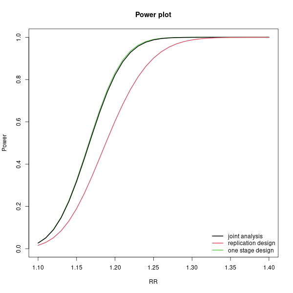
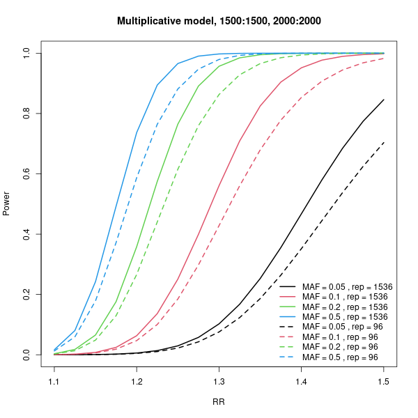
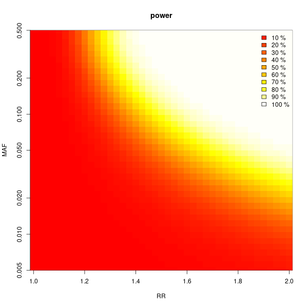
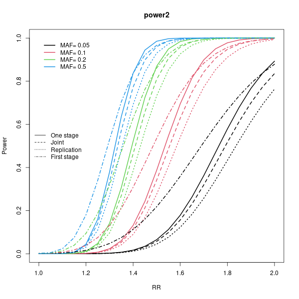

# CATS: joint power of a non-symmetric two-stage GWA design

R package for power estimation for a two-stage genome-wide association design. It is a modification of the code from Skol et al. (2006) that lets the relative risk, the case-control ratios and the allele frequencies differ between the two stages.

For a given design, CATS reports the power of:

- a **one-stage** study, where all samples are genotyped for all markers,
- the **first stage** of a two-stage study,
- the second stage analysed as a **replication** study,
- the second stage analysed **jointly** with the first stage.

The full function reference is in [CATS-manual.pdf](CATS-manual.pdf).

## Installation

The package contains C code, so you need a compiler (on Linux this is normally already there).

From R:

```r
# install.packages("remotes")
remotes::install_github("aalbrechtsen/Rfun", subdir = "CATS")
```

or from the command line:

```bash
git clone https://github.com/aalbrechtsen/Rfun.git
R CMD INSTALL Rfun/CATS
```

## Run in R

```r
library(CATS)
cats(freq = 0.2, ncases = 500, ncases2 = 500, ncontrols = 1000, ncontrols2 = 1000,
     risk = 1.5, multiplicative = 1)
```

```
Expected Power is;
                   For a one-stage study = 0.94
      For first stage in two-stage study = 0.972
For second stage in replication analysis = 0.784
    For second stage in a joint analysis = 0.929
                                      pi = 0.5
```

The main arguments of `cats()`:

| Argument | Meaning |
|---|---|
| `freq`, `freq2` | minor allele frequency in stage 1 (and stage 2, if different) |
| `ncases`, `ncontrols` | number of cases and controls in stage 1 |
| `ncases2`, `ncontrols2` | number of cases and controls in stage 2 |
| `risk`, `risk2` | genotype relative risk in stage 1 (and stage 2) |
| `prevalence` | disease prevalence |
| `multiplicative`, `additive`, `dominant`, `recessive` | disease model (set one to 1) |
| `alpha` | genome-wide significance level |
| `pimarkers` | fraction of markers genotyped in stage 2 |
| `pisamples` | weight for the joint statistic (see `?cats`) |

The returned object holds the powers (`P.one.study`, `P.first.stage`, `P.rep.study`, `P.joint`) and the test thresholds, so it can be used in loops, as in the examples below.

## Plot examples

All four figures are made by [make_figures.R](make_figures.R).

### Which design is better



```r
library(CATS)
rr <- seq(1.1, 1.4, by = 0.01)
res <- sapply(rr, function(r) {
  x <- cats(freq = 0.3, ncases = 2000, ncontrols = 2000, ncases2 = 2000, ncontrols2 = 2000,
            risk = r, pimarkers = 0.01, alpha = 5e-7)
  c(joint = x$P.joint, replication = x$P.rep.study, one = x$P.one.study)
})
plot(rr, res["one", ], type = "l", lwd = 2, col = 3, ylim = 0:1,
     xlab = "RR", ylab = "Power", main = "Power plot")
lines(rr, res["joint", ], lwd = 2, col = 1)
lines(rr, res["replication", ], lwd = 2, col = 2)
legend("bottomright", c("joint analysis", "replication design", "one stage design"),
       col = c(1, 2, 3), lwd = 2, bty = "n")
```

### Number of SNPs for replication



```r
library(CATS)
RR <- seq(1.1, 1.5, by = 0.025)
maf <- c(5, 10, 20, 50) / 100
power.J96 <- power.J1536 <- c()
for (m in maf) {
  J1 <- J2 <- c()
  for (r in RR) {
    J1 <- c(J1, cats(freq = m, ncases = 1500, ncontrols = 1500, ncases2 = 2000, ncontrols2 = 2000,
                     risk = r, pimarkers = 96 / 300000, alpha = 0.05 / 300000)$P.joint)
    J2 <- c(J2, cats(freq = m, ncases = 1500, ncontrols = 1500, ncases2 = 2000, ncontrols2 = 2000,
                     risk = r, pimarkers = 1536 / 300000, alpha = 0.05 / 300000)$P.joint)
  }
  power.J96 <- cbind(power.J96, J1)
  power.J1536 <- cbind(power.J1536, J2)
}
col <- seq_along(maf)
matplot(RR, power.J1536, type = "l", lty = 1, lwd = 2, col = col, ylim = 0:1, ylab = "Power",
        main = "Multiplicative model, 1500:1500, 2000:2000")
matlines(RR, power.J96, lty = 2, lwd = 2, col = col)
legend("bottomright", c(paste("MAF =", maf, ", rep = 1536"), paste("MAF =", maf, ", rep = 96")),
       col = col, lwd = 2, bty = "n", lty = rep(1:2, each = length(maf)))
```

### Heatmap of power



```r
library(CATS)
rr <- seq(1, 2, by = 0.025)
sc <- super.cats(rr, by = length(rr), ncases = 765, ncontrols = 1274, ncases2 = 100, ncontrols2 = 100,
                 alpha = 0.001, prevalence = 0.01)
plot(sc, main = "power", file = NULL)
```

### Design and MAF



```r
library(CATS)
rr <- seq(1, 2, by = 0.05)
maf <- c(0.05, 0.1, 0.2, 0.5)
c2 <- curve.cats(rr, maf, ncases = 600, ncontrols = 600, ncases2 = 600, ncontrols2 = 600,
                 alpha = 0.000001, prevalence = 0.01)
plot(c2, type = "One", main = "power2", ylab = "Power", xlab = "RR", file = NULL, col = 1:4)
lines.cats(c2, type = "Replication", lty = 3)
lines.cats(c2, type = "Joint", lty = 2)
lines.cats(c2, type = "First", lty = 4)
legend("left", c("One stage", "Joint", "Replication", "First stage"), lty = 1:4, bty = "n")
```

## Cite

Skol, AD, Scott, LJ, Abecasis, GR, Boehnke, M (2006). Joint analysis is more efficient than replication-based analysis for two-stage genome-wide association studies. *Nat. Genet.* 38(2): 209–213.

## Changes

- **1.03** (2026): moved to GitHub from popgen.dk. Registers the `print`, `summary` and `plot` methods so they work in current R.
- **1.02** (2015): last version on popgen.dk.
