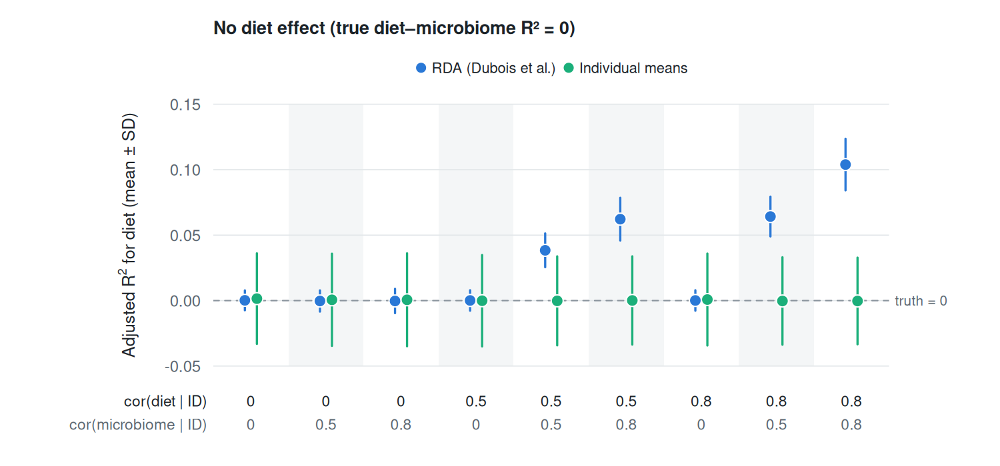
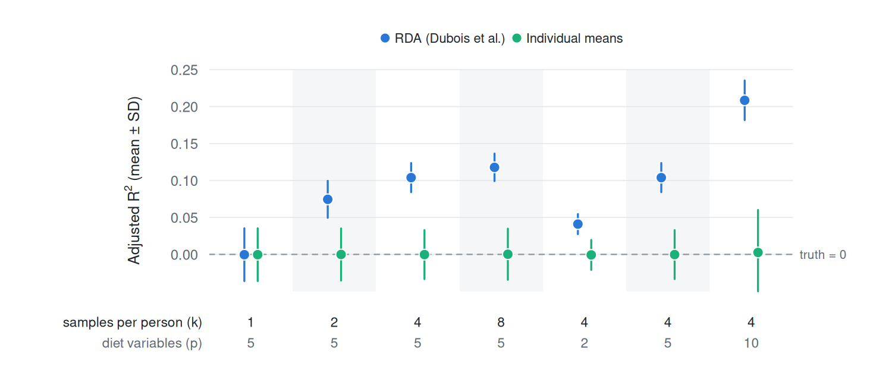
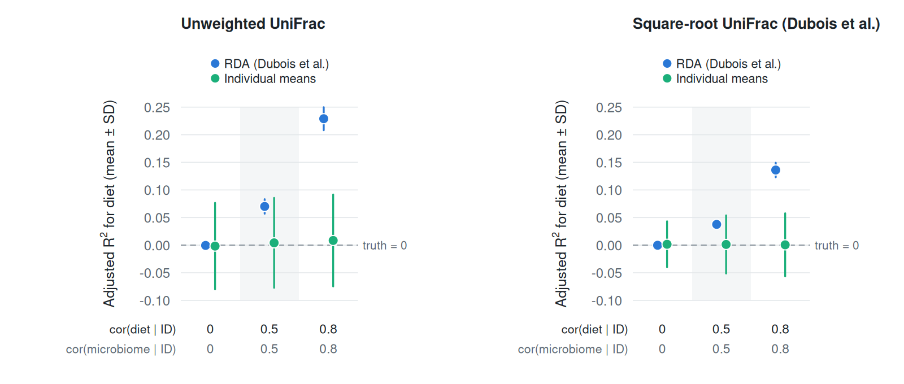
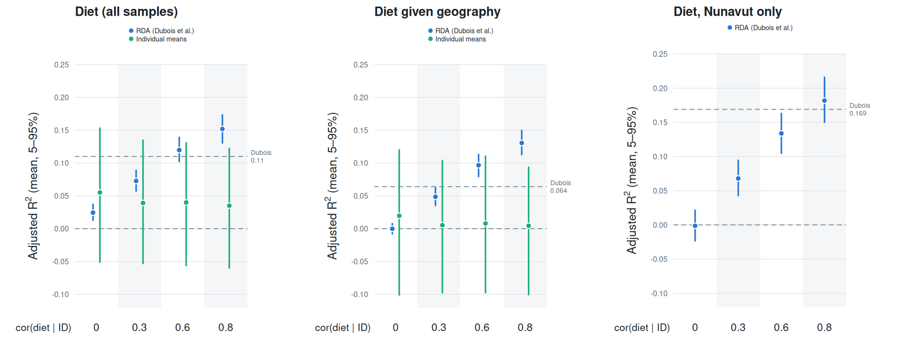
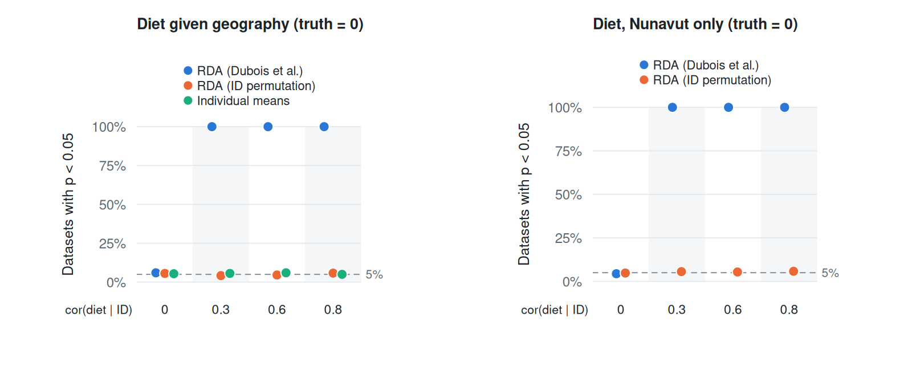

# Ignoring repeated samples inflates diet–microbiome RDA

*Simulation report · Distance-based RDA · 16 Nov 2026*

Dubois et al. (2017) analysed 128 repeated samples from 24 people with distance-based RDA, but treated the samples as independent. These simulations test what that does to significance and to the adjusted R² when diet has no effect, and when it has a known one.

Dubois, Girard, Lapointe & Shapiro (2017). The Inuit gut microbiome is dynamic over time and shaped by traditional foods. *Microbiome* 5:151. [PMC5689144](https://pmc.ncbi.nlm.nih.gov/articles/PMC5689144/)

The same report as a web page, with figures that follow the light or dark theme: [report/rda_repeated_report.html](report/rda_repeated_report.html) (download and open in a browser).

## Summary

- **98–100%** of null datasets give p < 0.05 for diet when samples are treated as independent and both diet and microbiome are moderately to strongly correlated within people
- **+0.04 to +0.21** mean adjusted R² for a diet with no effect (truth = 0), depending on within-person correlation and the number of diet variables
- **≈ 5%** false-positive rate when whole individuals are permuted (ID permutation) or individual means are analysed

- **Significance.** Freely permuting samples assumes each sample is independent. When diet and microbiome are both stable within a person, between-person differences in the microbiome line up with between-person differences in diet by chance, and the free permutation test counts each person's samples as separate evidence. The false-positive rate goes from 5% to near 100%.
- **Explained variation.** The adjusted R² corrects for the number of predictors assuming independent samples, so it does not remove this chance between-person fit. With no diet effect it averages 0.04–0.10 for five diet variables and 0.21 for ten. With a true effect, the naive adjusted R² carries the same bias on top of the true value. In these simulations the bias is upward.
- **Remedies.** Permuting whole individuals (ID permutation) fixes the p-value but not the R². Analysing individual means fixes both, at the cost of power, because it uses one observation per person.
- **Matched to Dubois et al.** With their design and analysis (128 samples, 16 diet variables, square-root UniFrac), a diet with no effect beyond geography gets p < 0.05 in 100% of naive analyses once diet habits are even modestly stable within people. Its naive adjusted R² is 0.05–0.13 given geography and 0.07–0.18 within Nunavut, bracketing the reported 6.4% and 17%.

## The study design and the problem

Dubois et al. followed 15 Inuit participants in Resolute Bay (Nunavut) and 9 people in Montréal, with toilet-paper samples taken about monthly: 128 samples, a mean of 5.3 per person. The number of samples per person is not reported; Table S1 lists 61 samples collected in Nunavut, which suggests about 4 per Nunavut participant and 7–8 per Montréal participant. With each sample, a questionnaire recorded how often food categories were eaten in the previous 48 h. These were pooled into categories (Table S3), and the RDA in their Figure 3b has 16 of them. The mean frequency per day of each category, centred and scaled, was the set of explanatory variables. The response was square-root-transformed unweighted UniFrac distances, analysed by RDA in vegan, with adjusted R² and permutation tests with 9,999 permutations.

They report three diet results, all from this RDA on all of a group's samples:

- **Diet, all participants:** adjusted R² = 0.11, p = 0.001 (their Figure 3b).
- **Diet after controlling for geography** (partial RDA): adjusted R² = 0.064, p = 0.001 (text only).
- **Diet, Nunavut participants only:** adjusted R² = 0.169, p = 0.004 (text only).

Individual identity explained 45% of unweighted UniFrac variation and geography 4% (their Figure 2, permanova). The methods do not mention individual in the RDA or any restriction of the permutations, so the permutations were presumably free (the vegan default).

### Which figure corresponds to which result

| Dubois et al. result | Their analysis | Matched simulation in this report |
|---|---|---|
| Diet, adjusted R² = 0.11 | RDA of diet on all 128 samples, free permutation (their Figure 3b) | Figure 4, left panel, blue points |
| Diet given geography, 0.064 | Partial RDA, geography as condition | Figure 4, middle panel, blue points; Figure 5, left |
| Diet, Nunavut only, 0.169 | RDA of diet on the Nunavut samples | Figure 4, right panel, blue points; Figure 5, right |

Figures 1–3 are simpler simulations with no geography. Their blue points use the same analysis as the paper (RDA of diet on all samples with free permutation). Figures 1–2 use 24 people with equal numbers of samples and Euclidean distance, to show how the bias depends on the within-person correlations, the number of samples and the number of diet variables. Figure 3 uses the paper's sample sizes (128 samples from 24 people) and 16 diet variables, with UniFrac distances.

That matters because both sides of the regression are clustered. Individual identity dominates the microbiome, and dietary habits are also stable within people. Samples from the same person are then not independent pieces of evidence about the diet–microbiome association.

## Simulation design

Each simulated dataset has 24 individuals with *k* samples each and *p* diet variables. Diet and a 20-dimensional latent microbiome are generated with an individual component and a sample component:

> d<sub>ij</sub> = √ρ<sub>d</sub> · a<sub>i</sub> + √(1−ρ<sub>d</sub>) · e<sub>ij</sub>  
> z<sub>ij</sub> = d<sub>ij</sub>Γ + √ρ<sub>y</sub> · b<sub>i</sub> + √(1−ρ<sub>y</sub>) · w<sub>ij</sub>

Three separate quantities are set in each scenario:

- **ρ<sub>d</sub> = cor(diet | ID), within-individual correlation of diet:** the correlation between two diet records from the same person, or equivalently the share of diet variance that lies between people (stable habits). It is about diet only.
- **ρ<sub>y</sub> = cor(microbiome | ID), within-individual correlation of the gut microbiome:** the correlation between two microbiome samples from the same person, the share of microbiome variance that lies between people. It is about the microbiome only.
- **Diet effect, the true diet–microbiome association:** Γ, scaled so diet explains a chosen share of microbiome variation in the population (true R²). It is 0 (no effect) unless stated, and 0.05 or 0.11 in the true-effect scenarios.

The first two are independent of the third. With no diet effect, the individual parts of diet (a<sub>i</sub>) and microbiome (b<sub>i</sub>) are drawn independently, so any diet–microbiome association a method reports is spurious. Distances are Euclidean on *z*. For the UniFrac runs, *z* sets the log-abundances of 300 taxa on a random tree, counts are drawn at depth 3,000, and unweighted UniFrac is computed from presence and absence. Each scenario has 1,000 replicates (500 for UniFrac) and 499 permutations per test.

Three analyses are compared on every dataset:

- **RDA (Dubois et al.):** RDA on all samples, rows permuted freely, as described in the paper. Called the naive analysis below.
- **RDA (ID permutation):** The same RDA, but the permutation test moves whole individuals, keeping each person's samples together. Not used by Dubois et al. It changes only the p-value: its R² is identical to the paper's RDA, so it appears only in the false-positive figure (Figure 5).
- **Individual means:** RDA of each person's microbiome centroid on their mean diet (n = 24). This tests between-person association.

All three were checked against vegan (`rda`, `varpart`, `RsquareAdj`) and the UniFrac code against phyloseq; R² and adjusted R² match exactly.

## No diet effect

Here the true diet–microbiome association is 0 and only the two within-individual correlations vary. The naive test stays at the nominal 5% when either ρ<sub>d</sub> or ρ<sub>y</sub> is 0. Once both are above 0 it gives p < 0.05 in nearly every dataset (98% at ρ<sub>d</sub> = ρ<sub>y</sub> = 0.5, 100% at 0.8). RDA with ID permutation and the individual-means analysis stay at 4–6% throughout.

The adjusted R² should average 0. Naive RDA gives positive values that grow with ρ<sub>d</sub> × ρ<sub>y</sub>. Permuting individuals does not change the estimate, so it inherits the same bias. Individual means are unbiased.



**Figure 1.** Generic simulation, not matched to Dubois et al. Mean adjusted R² for diet (±1 SD across replicates) when diet has no effect on the microbiome (true R² = 0). Each group is one combination of the within-individual correlation of diet, cor(diet | ID) = ρ<sub>d</sub>, and of the gut microbiome, cor(microbiome | ID) = ρ<sub>y</sub>. n = 96 samples (24 individuals × 4 samples) for the RDA (blue). Individual means (green): one row per person, n = 24. Each person's microbiome is summarised by the centroid (average position) of their samples in the distance space, and their diet by the average of their diet records; the RDA then relates the 24 centroids to the 24 average diets. 5 diet variables, Euclidean distance, 1,000 replicates per scenario.

### More samples per person, more diet variables

At ρ<sub>d</sub> = ρ<sub>y</sub> = 0.8, the naive bias grows with the number of diet variables, from 0.04 with 2 variables to 0.21 with 10. With one sample per person (k = 1) there are no repeated measures and the bias disappears (adjusted R² ≈ 0, 5% false positives). With repeated samples it is 0.07, 0.10 and 0.12 for 2, 4 and 8 samples per person: the extra samples add no new people. Dubois et al. used 16 food categories, so a larger bias would be expected there.



**Figure 2.** Generic simulation, not matched to Dubois et al. Mean adjusted R² (±1 SD) with no diet effect, ρ<sub>d</sub> = ρ<sub>y</sub> = 0.8, varying samples per person (*k* = 1, 2, 4, 8, with 5 diet variables; k = 1 means no repeated samples) and the number of diet variables (*p*, with 4 samples per person). Always 24 individuals, so n = 24, 48, 96 and 192 samples for k = 1, 2, 4 and 8 (n = 96 in the p groups) for the RDA (blue). Individual means (green): one row per person, n = 24. Each person's microbiome is summarised by the centroid (average position) of their samples in the distance space, and their diet by the average of their diet records; the RDA then relates the 24 centroids to the 24 average diets. Euclidean distance, 1,000 replicates per scenario.

### The paper's sample sizes and 16 diet variables, with UniFrac

Figure 3 uses the paper's sample sizes (128 samples from 24 people: 15 with 4 samples, 5 with 8 and 4 with 7) and its 16 diet variables, without geography. The left panel uses unweighted UniFrac on simulated presence and absence of taxa; the right panel uses square-root unweighted UniFrac, the distance Dubois et al. used. In the right panel the blue points are the paper's analysis: RDA of diet on all samples with free permutation. With no diet effect it gives a mean adjusted R² of 0.00, 0.04 and 0.14 at cor(diet | ID) = cor(microbiome | ID) = 0, 0.5 and 0.8, and p < 0.05 in 4%, 100% and 100% of datasets. With untransformed UniFrac the values are 0.00, 0.07 and 0.23.

RDA with ID permutation gives correct p-values (4–6%). Because people have different numbers of samples, it swaps only people with the same number of samples. The individual-means analysis uses 4 randomly chosen samples per person, so every person's mean is equally precise. With all samples, means of 4 samples vary more than means of 7–8 in both diet and microbiome, and the adjusted R² picks that up (about 0.05 at cor(diet | ID) = 0). With 4 samples each, individual means give adjusted R² ≈ 0 and 5–7% false positives.

The square root compresses large distances, so individual identity explains less of the variation for the same cor(microbiome | ID), and the bias is smaller. The bias depends on how much individual identity explains in the distances actually analysed. The study-matched runs below are calibrated to the paper's 45% for individual identity.



**Figure 3.** Simulation with the paper's sample sizes and number of diet variables, but no geography. Mean adjusted R² for diet (±1 SD) with no diet effect (true R² = 0). Left: unweighted UniFrac. Right: square-root unweighted UniFrac, the distance used by Dubois et al. n = 128 samples from 24 individuals (15 with 4 samples, 5 with 8, 4 with 7) for the RDA. 16 diet variables, 500 replicates per scenario. ID permutation swaps only people with the same number of samples. Individual means (green): one row per person, n = 24. Each person's microbiome is summarised by the centroid (average position) of 4 randomly chosen samples in the distance space, and their diet by the average of the same 4 diet records; the RDA then relates the 24 centroids to the 24 average diets. Using 4 samples for everyone makes all averages equally precise.

## Simulation matched to Dubois et al.

The second set copies the study and its analysis as closely as the paper allows:

- 15 Nunavut participants with 4 samples each and 9 Montréal participants with 7–8 samples each: 128 samples.
- 16 diet variables, centred and scaled.
- Response: square-root-transformed unweighted UniFrac, analysed by RDA with adjusted R² and free permutation, as in the paper.
- Three analyses: diet on all samples (paper: 0.11), diet given geography (paper: 0.064), and diet in Nunavut participants only (paper: 0.169).
- The microbiome is set so that individual identity explains 44% and geography 4% of UniFrac variation, matching the paper's 45% and 4%. That needs cor(microbiome | ID) = 0.8 on the latent scale, because sampling taxa adds noise to UniFrac.
- Geography shifts both diet and the microbiome, but diet itself has no effect. Diet's within-person correlation cor(diet | ID) is not reported, so it is varied from 0 to 0.8.

RDA with ID permutation swaps whole individuals that have the same number of samples, which here means within a region (Nunavut 4 samples; Montréal 7 or 8). It is therefore shown for diet given geography and for Nunavut only, where that is the right comparison. The individual-means analysis is not possible for Nunavut only, because 15 people cannot support 16 predictors.

Diet on all samples is not a clean no-effect test. Diet differs between regions and so does the microbiome, so diet is genuinely associated with the microbiome through geography, and any analysis of diet alone should detect something. The clean tests are **diet given geography** and **Nunavut only**, where the true adjusted R² is 0.

In both clean tests the naive RDA is only right when diet has no within-person stability. From cor(diet | ID) = 0.3 upward it gives p < 0.05 in 100% of datasets. Its mean adjusted R² for diet given geography is 0.05, 0.10 and 0.13 at cor(diet | ID) = 0.3, 0.6 and 0.8, bracketing the paper's 0.064. For Nunavut only it is 0.07, 0.13 and 0.18, bracketing the paper's 0.169. RDA with ID permutation brings the false-positive rate back to 4–6%, and individual means give adjusted R² ≈ 0.

For diet on all samples, the naive adjusted R² is 0.07–0.15 for cor(diet | ID) = 0.3–0.8, around the paper's 0.11, which mixes the geography-driven association with the same repeated-sample bias.

With a true diet effect (R² = 0.05 on the latent scale, cor(diet | ID) = 0.6), the naive estimates rise only a little above the null values (0.12 for diet, 0.10 for diet given geography, 0.14 for Nunavut only). So in this design, the size of the naive adjusted R² says little about whether diet has any effect.



**Figure 4.** Mean adjusted R² with 5th–95th percentiles in the study-matched simulation with no diet effect (square-root unweighted UniFrac, 500 replicates; n = 128 samples from 24 individuals, and n = 60 samples from 15 individuals for Nunavut only), by diet's within-person correlation cor(diet | ID). Left: diet on all samples, the analysis behind the paper's 0.11 (their Figure 3b); it also picks up the regional difference. Middle: diet given geography (paper 0.064). Right: diet in Nunavut participants only (paper 0.169). In the middle and right panels the truth is 0. Blue points are the paper's analysis. Dashed lines: values reported by Dubois et al. (0.11, 0.064 and 0.169). Individual means (green): one row per person, n = 24. Each person's microbiome is summarised by the centroid (average position) of their samples in the distance space, and their diet by the average of their diet records; the RDA then relates the 24 centroids to the 24 average diets (given geography in the middle panel). It uses all of each person's samples and is not possible for Nunavut only, where 15 people cannot support 16 diet variables.



**Figure 5.** Share of datasets with p < 0.05 in the study-matched simulation for the two analyses where diet has no effect: diet given geography (n = 128 samples, 24 individuals) and diet in Nunavut participants only (n = 60 samples, 15 individuals); square-root unweighted UniFrac, 500 replicates. Dashed line: nominal 5%. Individual means (green): one row per person (n = 24), the centroid of each person's samples related to their average diet, given geography.

*Table 1.* Share of datasets with p < 0.05 in the study-matched simulation. Columns: distance (E = Euclidean, U = square-root UniFrac) and cor(diet | ID); R² is the true diet effect where it is not 0. Diet-alone rows test a real association, since diet and microbiome both differ by region. Bold: false-positive rate above 10% in a test whose null is true. Paper values: diet 0.11, diet | geography 0.064, Nunavut only 0.169 (all p ≤ 0.004).

| Analysis | E 0 | E 0.3 | E 0.6 | E 0.8 | E 0.6 (R²=0.05) | U 0 | U 0.3 | U 0.6 | U 0.8 | U 0.6 (R²=0.05) |
|---|---|---|---|---|---|---|---|---|---|---|
| Diet · RDA (Dubois et al.) | 95% | 100% | 100% | 100% | 100% | 98% | 100% | 100% | 100% | 100% |
| Diet · individual means | 18% | 14% | 12% | 11% | 31% | 26% | 17% | 15% | 14% | 17% |
| Diet \| geography · RDA (Dubois et al.) | 6% | **100%** | **100%** | **100%** | 100% | 6% | **100%** | **100%** | **100%** | 100% |
| Diet \| geography · RDA (ID permutation) | 5% | 5% | 4% | 5% | 72% | 6% | 4% | 5% | 6% | 28% |
| Diet \| geography · individual means | 5% | 4% | 4% | 4% | 13% | 5% | 6% | 6% | 5% | 5% |
| Nunavut only · RDA (Dubois et al.) | 6% | **84%** | **100%** | **100%** | 100% | 4% | **100%** | **100%** | **100%** | 100% |
| Nunavut only · RDA (ID permutation) | 6% | 4% | 4% | 4% | 33% | 5% | 6% | 5% | 6% | 16% |

## What this means for the 11%, 6.4% and 17%

The simulations do not show that diet has no effect in the Inuit data. They show that the published numbers cannot distinguish a diet effect from no effect. With 24 people, 16 diet variables and both diet and microbiome stable within people, a naive RDA gives an adjusted R² of 5–18%, with p ≈ 0.001, for a diet that does nothing beyond geography. The 6.4% (diet given geography) and the 17% (Nunavut only) are both within the range expected under that null, and the 11% also contains the diet–geography overlap.

Two quantities would settle it from their data: the within-person correlation of the diet frequencies, and a reanalysis that respects individuals. Permuting whole individuals within region gives a valid p-value for the same model. Analysing individual means gives estimates of explained variation that are not inflated.

### Suggested wording

> Dubois et al. (2017) investigated the association between diet and gut microbiome composition using distance-based redundancy analysis (RDA) of unweighted UniFrac distances, including repeated samples from 24 individuals. They reported that diet explained 11% of community variation, decreasing to 6.4% after accounting for geography. However, the RDA apparently did not account for repeated measurements from the same individuals. Because both dietary habits and microbiome composition are correlated across time points within individuals, this approach overstates the independent information available and inflates statistical significance. In simulations matching their design and analysis (128 samples from 24 individuals, 16 food categories, square-root unweighted UniFrac), a diet with no effect beyond geography was declared significant in all datasets once dietary habits were even modestly stable within individuals. Its adjusted R² averaged 5–13% after controlling for geography and 7–18% within Nunavut, comparable to the reported 6.4% and 17%. Permuting whole individuals restored correct p-values, and analysing individual means gave unbiased estimates of explained variation.

## Limits of these simulations

- The number of samples per person in Dubois et al. is not reported. The study-matched runs assume 4 per Nunavut participant and 7–8 per Montréal participant (128 in total), based on Table S1. Figures 1–2 use equal numbers of samples per person; Figure 3 uses the same assumed split as the study-matched runs.
- Diet variables are simulated as correlated-within-person normal variables. Real frequencies from a 48 h recall are counts (0, 0.5, 1, … per day), skewed, correlated with each other, and some traditional foods are eaten only in Nunavut. This changes the effective number of predictors but not the mechanism.
- The UniFrac runs use a random tree and simple presence/absence sampling. The study-matched runs and the right panel of Figure 3 use square-root UniFrac, as in the paper; the left panel of Figure 3 uses untransformed distances.
- The direction of the R² bias is upward when the diet effect is the same within and between people. If the within-person and between-person effects differ in sign, or if unmeasured person-level factors confound diet, the naive estimate can be biased in either direction.
- Diet's within-person correlation is not reported for this study, so the study-matched results are shown across a range (0–0.8).
- The paper does not name the vegan function or the permutation scheme. We assume a distance-based RDA (as `capscale` or `dbrda`) with free permutations, the vegan default.

## Code

### Files

| File | Makes |
|---|---|
| `sim_repeated_rda_lib.R` | Shared functions: dbRDA (McArdle & Anderson), adjusted R², permutation tests, unweighted UniFrac |
| `sim_repeated_rda.R` | Report Figures 1–2: 24 people, equal samples per person, Euclidean distance |
| `sim_k1.R` | One sample per person (k = 1) for Figure 2 |
| `sim_unifrac_paper.R` | Figure 3: the paper's sample sizes (15 × 4, 5 × 8, 4 × 7 samples) and 16 diet variables, UniFrac and square-root UniFrac |
| `sim_unifrac_sqrt.R` | Square-root UniFrac with 4 samples per person and 5 diet variables (not shown in the report) |
| `sim_dubois_calibrated.R` | Figures 4–5 and Table 1: matched to Dubois et al. (geography, Nunavut only, individual 45% and geography 4% of UniFrac variation) |
| `plot_sim_results.R` | All figures as PNG, PDF and SVG in `plots/` |
| `report/build_report.py` | Builds `report/rda_repeated_report.html` from `report/report_template.html`, the SVG figures and the results tables |
| `report/build_readme.py` | Builds this README from the same template, with the PNG figures (the Code section comes from `report/readme_code_section.md`) |
| `*_results.tsv` | Simulation results (rejection rate, mean R², adjusted R² and its spread per scenario and method) |

### Running

The scripts use `parallel::mclapply` with up to 80 cores. Set `OPENBLAS_NUM_THREADS=1` so the workers don't also start threaded BLAS. Run them from this folder in this order, because the later ones add rows to `sim_repeated_rda_results.tsv`:

```bash
OPENBLAS_NUM_THREADS=1 Rscript --vanilla sim_repeated_rda.R
OPENBLAS_NUM_THREADS=1 Rscript --vanilla sim_k1.R
OPENBLAS_NUM_THREADS=1 Rscript --vanilla sim_unifrac_sqrt.R
OPENBLAS_NUM_THREADS=1 Rscript --vanilla sim_unifrac_paper.R
OPENBLAS_NUM_THREADS=1 Rscript --vanilla sim_dubois_calibrated.R
Rscript --vanilla plot_sim_results.R
python3 report/build_report.py
python3 report/build_readme.py
```

Needs R with `ape`, `svglite` and `parallel`; the dbRDA was checked against vegan 2.6-4 (`rda`, `varpart`, `RsquareAdj`). Tested with R 4.3.3.

Plot file names are from an earlier numbering. Report Figure 1 is `sim_fig2_null_adjR2`, Figure 2 `sim_fig3_k_p`, Figure 3 `sim_fig4_unifrac`, Figure 4 `sim_fig6_dubois_matched` and Figure 5 `sim_fig7_dubois_reject`.
